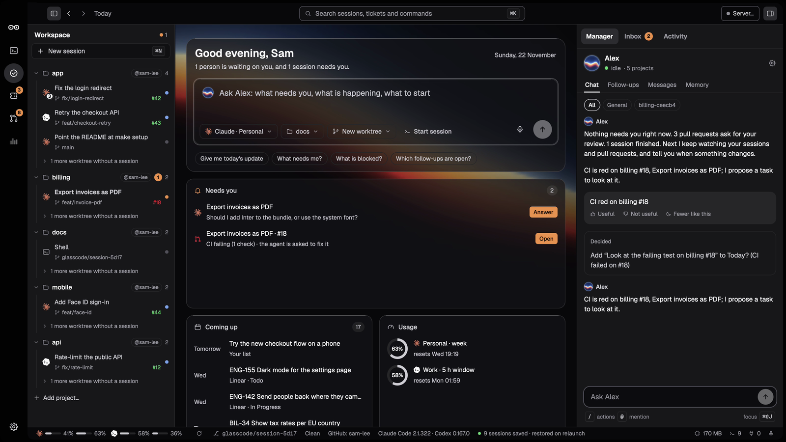

## Glasscode

**Coding, through your glasses.** Free to use, build on and share.

A workspace for running Claude Code and Codex agents side by side in git worktrees, several on one
worktree if you like, with a manager above your sessions and a companion app for Meta Ray-Ban
Display glasses.

[Website](https://glasscode.io) · [Repository](https://github.com/glasscode-ide/glasscode) ·
[Docs](https://github.com/glasscode-ide/glasscode/blob/main/docs/README.md) ·
[Contributing](https://github.com/glasscode-ide/glasscode/blob/main/CONTRIBUTING.md)

 

### The team

| | Works on |
|---|---|
| **Sahan Nishshanka** · [@svhozt](https://github.com/svhozt) | Session engine, the manager agent, server and mobile hand-off, voice and the glasses display, security architecture |
| **Shahariar Ali Bijoy** · [@ShahriarBijoy](https://github.com/ShahriarBijoy) | GPUI component library, developer experience, multi-agent orchestration, Windows support, release engineering |
| **Lasan Gonsal Korala** · [@lasangnya](https://github.com/lasangnya) | Launch video, publicity |

### Contact

Interested in Glasscode, want to work with us, or have a question? Write to
[nasvimukthi23@gmail.com](mailto:nasvimukthi23@gmail.com) or visit [glasscode.io](https://glasscode.io).
For a bug or an idea, open an [issue](https://github.com/glasscode-ide/glasscode/issues).

### Sponsored by

<a href="https://hub.ki/en/">
  <picture>
    <source media="(prefers-color-scheme: dark)" srcset="hubki-white.svg" />
    
  </picture>
</a>

The HUB.KI logo belongs to HUB.KI and is shown because they sponsor Glasscode.
